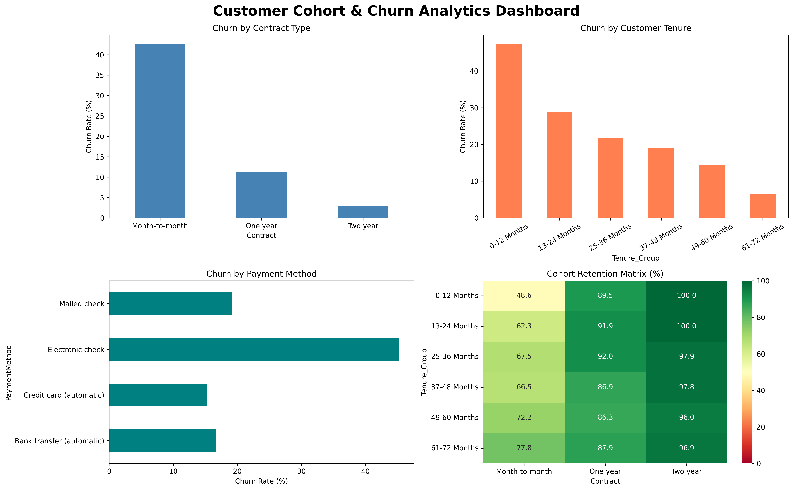

# Customer Cohort & Churn Analytics

## Project Overview
This project was developed as Task 3 of the DATHEON Data Analytics & Power BI Internship. It analyzes telecom customer churn, identifies high-risk customer segments, and provides strategic retention recommendations.

## Tools and Technologies
- Python
- Pandas
- NumPy
- Matplotlib
- Seaborn
- Google Colab

## Dataset
IBM Telco Customer Churn dataset provided through the DATHEON internship portal.

- Total customers: 7,043
- Total attributes: 21

## Key Performance Indicators

| Metric | Value |
|---|---:|
| Total Customers | 7,043 |
| Churned Customers | 1,869 |
| Retained Customers | 5,174 |
| Churn Rate | 26.54% |
| Retention Rate | 73.46% |

## Analysis Performed
- Data cleaning and preprocessing
- Contract-wise churn analysis
- Customer tenure cohort analysis
- Payment method analysis
- Monthly charges analysis
- High-risk customer segmentation
- Cohort retention matrix
- Consolidated analytics dashboard

## Dashboard

## Key Findings
- Month-to-month customers have a churn rate of 42.71%.
- Two-year contract customers have a churn rate of 2.83%.
- Month-to-month customers with 0–12 months of tenure have a churn rate of 51.35%.
- Electronic check users have the highest observed churn among payment methods.

## Strategic Recommendations
- Encourage long-term contracts.
- Improve first-year customer engagement.
- Provide proactive technical support.
- Introduce loyalty rewards and personalized retention offers.

## Project Files
- Customer_Cohort_Churn_Analytics.ipynb
- Customer_Churn_Dashboard.png
- Customer_Churn_Final_Report.pdf

## Analysis Limitations
The dataset represents a customer snapshot. The retention matrix shows observed retention across tenure groups rather than historical cohort retention curves.

## Author
Nikitha Gurrala

DATHEON – Data Analytics & Power BI Internship | Task 3
